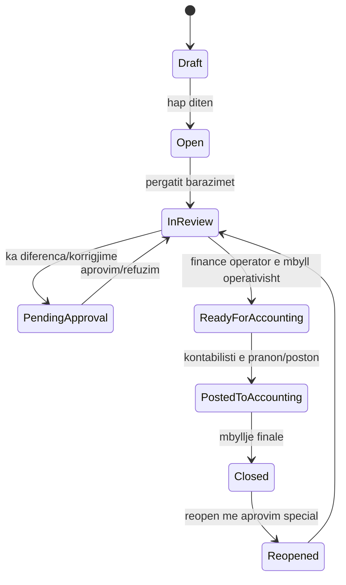
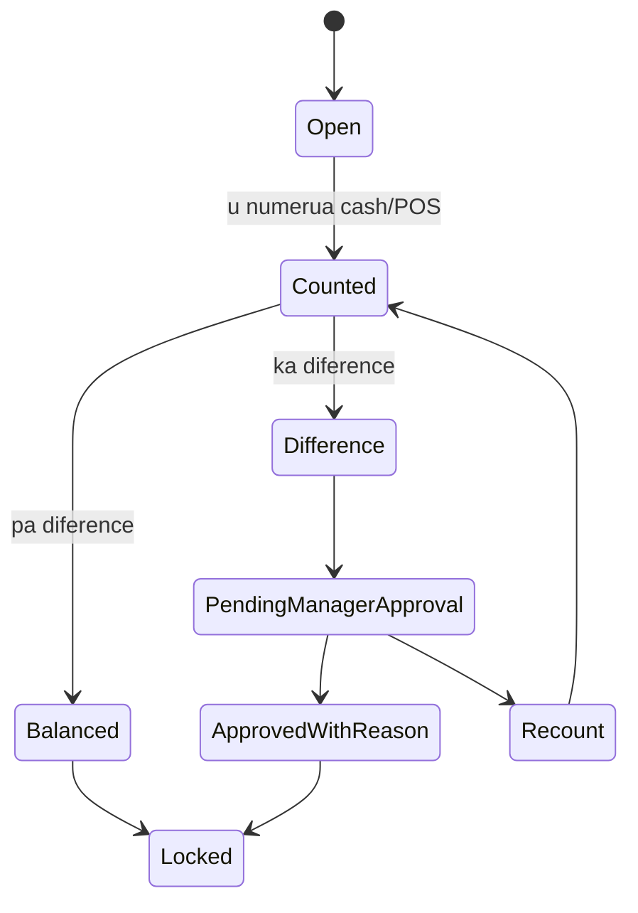

# Finance Operations Screen — Workflow Spec

**Data:** 2026-06-29
**Status:** canonical workflow spec / draft për validim live me PLANET
**Lidhet me:** `Finance_Operations_PLANET_KABI_2026-06-29.md`
**Qëllimi:** të specifikojë ekranet, rrjedhat, rolet dhe rregullat për modulin **Finance Operations** në iData+.

---

## 1. Parimi i modulit

Finance Operations është moduli ku kontrollohet puna ditore e parave dhe pagesave, para se ato të kalojnë në kontabilitet zyrtar.

Ky modul nuk është GL dhe nuk është deklarim TVSH. Ai është shtresa operative që mbledh, kontrollon, aprovon dhe dorëzon evidence të pastër për Accounting.

**Në PLANET:** fokusi është barazimi i kamarierëve/arkatarëve, tavolinave, cash-it, POS terminaleve, shpenzimeve dhe dorëzimit të parave në zyrë.
**Në KABI:** e njëjta logjikë përdoret më vonë për barazimin e shoferëve/ambulantëve, cash/kredi, kthime, gajbe dhe pagesa/avansa.

---

## 2. Kufiri Finance Operations vs Accounting

| Shtresa | Çfarë bën | Kush e përdor |
| --- | --- | --- |
| Finance Operations | Cash/card/bank daily control, saldo/float, worker settlement, expenses, POS terminal reconciliation, cash office, handover package | Vajza e financave, menaxheri, pronari |
| Accounting | GL, TVSH, AR/AP, libra tatimorë, mbyllje periudhe, pasqyra, postim zyrtar | Kontabilisti / financa e autorizuar |

Rregulli: **Finance Operations prodhon evidence; Accounting e poston dhe e mbyll.**

Nuk duhet të ketë përzierje ku vajza e financave pa rol kontabilisti ndryshon GL, dhe kontabilisti nuk duhet të detyrohet të bëjë punën operative të barazimit ditor.

---

## 3. Objektivat e ekranit

Ekrani duhet të përgjigjet shpejt në këto pyetje:

1. Sa cash duhet të jetë në zyrë sot?
2. Sa cash pritet nga secili kamarier/arkatar?
3. Sa pagesa janë me kartë dhe në cilin POS terminal/bankë?
4. Cilat tavolina/porosi kanë krijuar këto shuma?
5. Kush ka diferencë dhe pse?
6. Kush ka marrë para nga zyra dhe me çfarë arsye?
7. Cilat shpenzime janë bërë sot?
8. A është dita gati për t’iu dorëzuar kontabilistit?
9. Çfarë është hapur, çfarë është mbyllur, çfarë pret aprovim?

---

## 4. Rolet

| Rol | Përshkrimi | Qasje kryesore |
| --- | --- | --- |
| Group Owner / Pronari | Sheh nivel grupi dhe raporte të konsoliduara kur ka permission | All read, approval high-risk, override |
| Tenant Admin | Admin për PLANET ose KABI | Config, users, permissions, locations, payment methods |
| Finance Operator | Vajza e financave / personi që kontrollon paranë | Daily finance dashboard, worker settlement, expenses, handover |
| Manager | Menaxher salle/operacional | Approval për void/discount/transfer/difference; shikon shift/day |
| Cashier / Arkatar | Nëse ka arkë të veçantë | Cash drawer, payments, own settlement |
| Waiter / Kamarier | Nuk menaxhon financa; vetëm sheh detyrimet e veta nëse lejohet | Own tables/orders/payments summary |
| Accountant | Merr handover, rakordon, poston, mbyll periudhë | Read finance evidence, post accounting, close period |
| iCode Support | Break-glass vetëm me aprovim/arsye/kohë/audit | No default business-data access |

---

## 5. Rregulli i permission-eve

Për çdo feature përdorim action-level permissions:

- `read`
- `create`
- `modify`
- `cancel_correct`
- `print`
- `export`
- `approve`
- `close`
- `reopen`

Rregull bazë:

- Kamarieri nuk sheh financat e tjerëve.
- Finance Operator sheh dhe përgatit settlement, por nuk mbyll GL.
- Manager aprovon diferenca/korrigjime operative.
- Accountant poston/rakordon, por nuk manipulon POS workflow pa audit.
- Çdo veprim sensitiv ka audit log.

---

## 6. Konceptet kryesore të të dhënave

| Entitet | Përshkrimi |
| --- | --- |
| `finance_day` | Dita financiare/operative për një biznes/lokacion. |
| `business_day` / `service_day` | Dita operative e restorantit, e ndarë nga data kalendarike. |
| `shift` | Ndërrimi i punës për kamarier/arkatar/menaxher. |
| `cash_office` | Zyra/arka qendrore ku mbahen paratë. |
| `cash_drawer` | Arkë fizike/logjike për një arkatar, shank ose lokacion. |
| `float_assignment` | Saldo/float që i jepet punëtorit në fillim. |
| `worker_settlement` | Barazimi i punëtorit për ditën/shift-in. |
| `settlement_payment_line` | Breakdown sipas cash/card/bank/borxh/POS terminal. |
| `cash_movement` | Hyrje/dalje cash nga zyra, me arsye dhe aprovues. |
| `expense_entry` | Shpenzim operativ, me kategori, dokument/foto dhe aprovues. |
| `pos_terminal_batch` | Totali i një POS terminali/banke për ditën/shift-in. |
| `finance_handover` | Paketa që i dorëzohet Accounting. |
| `finance_discrepancy` | Diferencë midis priturës dhe dorëzuarës. |

---

## 7. State model

### 7.1 Finance day



### 7.2 Worker settlement



---

## 8. Screen map

| ID | Screen | Qëllimi |
| --- | --- | --- |
| FO-00 | Finance Operations Home | Hyrja në modul, company/lokacion/day selector. |
| FO-01 | Daily Finance Dashboard | Pamja kryesore cash/card/bank/diferenca. |
| FO-02 | Business Day Control | Hapje/mbyllje dite, service day, statuset. |
| FO-03 | Saldo / Float Management | Dhënia/kthimi i saldos për punëtorë/arka/shank. |
| FO-04 | Worker Settlement List | Lista e kamarierëve/arkatarëve dhe statusi i barazimit. |
| FO-05 | Worker Settlement Detail | Detajet e një punëtori: tavolina, porosi, pagesa, cash, diferenca. |
| FO-06 | Table / Order Drilldown | Drilldown vetëm për audit: tavolina → porosi → pagesa → fiskalizim. |
| FO-07 | POS Terminal Reconciliation | Rakordim i pagesave me kartë sipas bankës/POS terminalit. |
| FO-08 | Cash Office / Safe | Gjendja e zyrës, hyrje/dalje cash, kush mori para. |
| FO-09 | Expenses & Withdrawals | Shpenzime operative dhe tërheqje cash me arsye. |
| FO-10 | Supplier / Other Payments | Pagesa furnitorëve ose pagesa të tjera jashtë POS-it. |
| FO-11 | Handover to Accounting | Paketa ditore për kontabilistin. |
| FO-12 | Approvals & Audit | Aprovime, refuzime, audit trail, historik korrigjimesh. |
| FO-13 | Reports | Raporte ditore/mujore sipas punëtorit, terminalit, lokacionit, shpenzimit. |

---

## 9. FO-01 — Daily Finance Dashboard

### 9.1 Komponentët kryesorë

- Selector: Business → Location → Business Day.
- Cards:
  - Cash i pritur
  - Cash i dorëzuar
  - Diferenca totale
  - Card/POS total
  - Shpenzime ditore
  - Cash në zyrë
  - Barazime të hapura
  - Barazime me diferencë
  - Fatura/kuponë me status fiskal problematik
- Lista “Needs attention”:
  - punëtorë pa barazim;
  - diferenca të paaprovuara;
  - POS terminal batch që nuk përputhet;
  - shpenzime pa dokument;
  - cash withdrawal pa arsye/aprovim;
  - tavolina/fatura të hapura pas cutoff-it.

### 9.2 Filtrat

- Data / business day
- Lokacion
- Shank / banak
- Kamarier / arkatar
- Mënyrë pagese
- POS terminal / bankë
- Status barazimi
- Status aprovimi

### 9.3 Veprime

- `Open worker settlement`
- `Open POS terminal reconciliation`
- `Register expense`
- `Register cash movement`
- `Prepare handover`
- `Export daily report`

---

## 10. FO-02 — Business Day Control

Ky ekran kontrollon ditën operative.

### 10.1 Fusha

- Business
- Location
- Business day date
- Calendar start/end timestamp
- Service day cutoff rule
- Opened by / opened at
- Closed by / closed at
- Status

### 10.2 Rregulla

- Nuk mbyllet dita nëse ka worker settlement të hapur.
- Nuk mbyllet dita nëse ka diferenca pa aprovim.
- Nuk mbyllet dita nëse ka POS terminal reconciliation të papërfunduar.
- Reopen kërkon permission `reopen` + arsye + audit.

### 10.3 Pyetje për PLANET

- A mbyllet dita saktësisht në 00:00 apo sipas turnit?
- Porositë/faturat pas 00:00 a hyjnë në ditë të re apo në service day të vjetër?
- A ka evente ku dita operative vazhdon deri në mëngjes?

---

## 11. FO-03 — Saldo / Float Management

Ky ekran menaxhon paratë fillestare që u jepen punëtorëve ose arkave.

### 11.1 Fusha

- Worker / cash drawer
- Business day
- Shift
- Amount given
- Currency
- Given by
- Given at
- Returned amount
- Difference
- Notes
- Approval status

### 11.2 Workflow

1. Finance Operator ose Manager jep saldo.
2. Punëtori e pranon saldon.
3. Në fund të shift-it saldo kthehet.
4. Sistemi e përfshin në worker settlement.

### 11.3 Rregulla

- Saldo nuk është shitje.
- Saldo nuk është shpenzim.
- Saldo është cash movement i kontrolluar midis zyrës dhe punëtorit.

---

## 12. FO-04/FO-05 — Worker Settlement

Ky është ekrani më i rëndësishëm për PLANET.

### 12.1 Lista

Kolonat:

- Worker
- Role
- Shift
- Tables served
- Orders count
- Cash expected
- Cash counted
- Card/POS total
- Expenses assigned
- Discounts/voids count
- Difference
- Status
- Approver

### 12.2 Detail

Tabs:

1. **Summary**
2. **Tables**
3. **Orders**
4. **Payments**
5. **Discounts / Voids**
6. **Expenses / cash movements**
7. **Audit**

### 12.3 Summary formula

Formula bazë:

```text
Cash expected =
  cash sales
  + cash collected for debt if applicable
  - approved expenses paid by worker
  - returns/refunds approved in cash
  +/- approved adjustments
```

```text
Difference =
  cash counted
  - cash expected
```

Card/POS nuk duhet të përzihet me cash. Ai rakordohet në FO-07.

### 12.4 Table drilldown

Për çdo tavolinë të punëtorit:

- table number / zone;
- opened at / closed at;
- waiter;
- total items;
- total amount;
- payment method;
- discount/void/transfer history;
- fiscal status;
- timeline.

### 12.5 Rregulla kritike

- Nëse fatura është shfaqur për pagesë, kthimi mbrapa kërkon manager approval.
- Anulimi i porosisë së shtypur kërkon arsye + approval.
- Transfer i tavolinës te kamarier tjetër kërkon approval.
- Zbritja kërkon PIN/approval.
- Çdo ndryshim pas printimit/fiskalizimit duhet të jetë correction/reversal, jo edit i thjeshtë.

---

## 13. FO-06 — Table / Order Drilldown

Ky është ekran auditues, jo ekran për ndryshim porosish.

Duhet të shfaqë:

- timeline e tavolinës;
- kush e hapi;
- kush shtoi artikull;
- kur u dërgua në kuzhinë/shank;
- kur u bë gati;
- kush e mbylli;
- pagesa;
- fiskalizimi;
- voids/discounts/transfers;
- approval chain.

Qëllimi është “What happened?” për çdo tavolinë/faturë.

---

## 14. FO-07 — POS Terminal Reconciliation

Ky ekran rakordon pagesat me kartë.

### 14.1 Entitetet

- Bank
- POS terminal
- Location
- Business day
- Batch number/reference
- System card total
- Bank/POS terminal slip total
- Difference
- Approved by

### 14.2 Workflow

1. Sistemi mbledh pagesat me kartë nga POS/faturat.
2. Finance Operator fut totalin nga POS terminali/banka.
3. Sistemi llogarit diferencën.
4. Nëse ka diferencë, kërkohet arsye/aprovim.
5. Pas rakordimit, shkon në handover për Accounting.

### 14.3 Rregulla

- Pagesat me kartë nuk konsiderohen cash në zyrë.
- Çdo terminal bankar duhet të ketë raport veç.
- Një pagesë me kartë duhet të dijë me cilin POS terminal është bërë.

---

## 15. FO-08 — Cash Office / Safe

Ky ekran tregon gjendjen e zyrës së parave.

### 15.1 Duhet të tregojë

- opening cash balance;
- cash received from workers;
- cash paid out as expenses;
- cash given as float;
- cash returned as float;
- cash taken by owner/Donat or authorized person;
- bank deposit prepared;
- closing cash balance.

### 15.2 Cash movement types

| Type | Shembull | Kërkon aprovim |
| --- | --- | --- |
| `float_out` | Saldo për kamarier | Po, sipas limitit |
| `float_return` | Kthim saldo | Jo/Po sipas diferencës |
| `worker_cash_in` | Dorëzim cash nga kamarieri | Jo |
| `expense_out` | Shpenzim ditor | Po sipas limitit |
| `owner_withdrawal` | Donati merr cash nga zyra | Po + arsye |
| `bank_deposit_out` | Cash dërgohet në bankë | Po |
| `correction` | Korrigjim diference | Po, gjithmonë |

---

## 16. FO-09 — Expenses & Withdrawals

### 16.1 Expense entry

Fushat:

- category;
- amount;
- payment method;
- paid by;
- requested by;
- approved by;
- supplier/person;
- reason;
- document/photo;
- business day;
- accounting status.

### 16.2 Rregulla

- Shpenzim pa arsye nuk lejohet.
- Shpenzim pa dokument mund të lejohet vetëm me flag `missing_document` dhe aprovim.
- Shpenzimi që prek Accounting duhet të kalojë në handover.
- Nuk lejohet hard delete; vetëm anulim/korrigjim.

---

## 17. FO-10 — Supplier / Other Payments

Ky ekran mbulon pagesa jashtë POS-it, p.sh. furnitorë, pagesa të tjera, avanse.

Nga backup-i kemi evidence për:

- `tblDocPagesatAvanset`
- `tblDocPagesatTjeraMaster/Detalet` si schema/procedure signal
- payment methods / bank links

Në iData+ këto duhet të lidhen me:

- supplier ledger / AP;
- cash/bank movement;
- handover to accounting;
- approval;
- audit.

---

## 18. FO-11 — Handover to Accounting

Ky ekran krijon paketën ditore për kontabilistin.

### 18.1 Përmbajtja e paketës

- daily finance summary;
- worker settlement summary;
- POS terminal reconciliation;
- expenses;
- cash movements;
- discrepancies;
- approvals;
- fiscal status exceptions;
- attachments/documents;
- export files.

### 18.2 State

```text
Draft -> Ready for review -> Approved by Finance -> Accepted by Accounting -> Posted/Closed
```

### 18.3 Rregulla

- Accounting nuk pranon handover nëse ka diferenca pa aprovim.
- Pas pranimit nga Accounting, ndryshimet kërkojnë correction/reversal.
- Handover duhet të ketë hash/version/audit që të dihet çfarë u dorëzua.

---

## 19. FO-12 — Approvals & Audit

Çdo approval duhet të ruajë:

- object type;
- object id;
- requested by;
- requested at;
- reason;
- approved/rejected by;
- approved/rejected at;
- before/after values;
- device/session;
- optional PIN/MFA confirmation.

Veprimet që kërkojnë approval:

- discount;
- void/cancel after order sent/printed;
- table transfer;
- reopen closed settlement/day;
- cash difference approval;
- expense above limit;
- owner withdrawal;
- manual payment correction;
- accounting handover correction.

---

## 20. FO-13 — Reports

### 20.1 Raporte ditore

- Daily cash report
- Worker settlement report
- POS terminal report
- Expenses report
- Cash office report
- Discrepancy report
- Approval report

### 20.2 Raporte mujore

- Cash/card/bank by day
- Sales collected by payment method
- Expenses by category
- Worker variance history
- POS terminal variance history
- Owner withdrawals
- Supplier/other payments

### 20.3 Drilldown

Çdo raport duhet të lejojë drilldown:

```text
Total -> day -> worker/location/terminal -> table/order/payment -> source document
```

---

## 21. PLANET-specific rules

Këto hyjnë në MVP për PLANET:

- tavolinat e punëtorit të shfaqen brenda worker settlement;
- porositë brenda tavolinës të shfaqen;
- pagesat cash/kartë të ndahen;
- POS terminali bankar të ruhet në pagesë;
- zbritjet/anulimet/transferet të shfaqen me approval;
- në fund të ditës sistemi të tregojë sa cash duhet të dorëzojë secili punëtor;
- cash në zyrë të rritet vetëm kur pranohet dorëzimi;
- shpenzimet të dokumentohen me arsye/person/dokument;
- handover të përgatitet për kontabilistin.

Këto mbeten për validim live:

- a bëhet barazimi për kamarier apo arkatar;
- si trajtohet shanku jashtë/brenda;
- a ka dy cash offices apo një;
- a ka më shumë se një POS terminal për bankë;
- si ndahet service day pas mesnatës;
- si trajtohen eventet.

---

## 22. KABI-specific adaptation

KABI përdor të njëjtin model Finance Operations, por jo të njëjtat ekrane PLANET.

Për KABI duhet më vonë:

- driver/van settlement;
- vehicle stock load/unload;
- cash/credit sales by route;
- returns/expired products;
- crate/gajbe balance;
- farmer advances;
- farmer monthly settlement;
- mobile POS/SEF offline status;
- proof of delivery.

Rregulli mbetet: Finance Operations evidence → Accounting posting.

---

## 23. Acceptance criteria

Moduli nuk quhet gati pa këto:

1. Finance Operator mund të hapë një business day dhe të shohë dashboard.
2. Mund të jepet saldo/float dhe të kthehet.
3. Worker settlement llogarit cash expected, cash counted dhe difference.
4. Tavolinat/porositë/pagesat e punëtorit shfaqen në detail.
5. Card/POS payments rakordohen sipas terminalit/bankës.
6. Cash office tregon opening, movements, closing balance.
7. Shpenzimet kanë arsye, kategori, person dhe approval sipas rregullit.
8. Diferencat nuk mbyllen pa approval.
9. Handover to Accounting krijohet vetëm kur dita është e pastër.
10. Audit log ruan çdo veprim sensitiv.
11. Reopen/correction kërkon permission dhe arsye.
12. Raportet eksportohen për ditë/muaj dhe kanë drilldown.

---

## 24. UI/UX notes

- Gjuha kryesore: Shqip.
- Stil: premium SaaS, white + navy, jo ERP klasik i vjetër.
- Ekrani kryesor duhet të jetë 1-2 klikime për informacionet kyçe.
- Diferencat dhe gjërat që kërkojnë vëmendje shfaqen qartë me ngjyra/status.
- Drilldown duhet të jetë i lehtë, por ndryshimet sensitive të jenë të bllokuara.
- Për mobile/tablet, Finance Operator/Manager duhet të shohë approvals dhe daily status, por punën kryesore e bën në desktop/tablet.

---

## 25. Open questions për takimin me PLANET Finance

Këto pyetje duhet t’i marrim para finalizimit të ekranit:

1. Kush e bën sot barazimin real: vajza e financave, menaxheri, arkatar apo Donati?
2. A barazohet secili kamarier veçmas?
3. A barazohet secili shank/banak veçmas?
4. A ka saldo fillestare fikse për punëtor?
5. Si dokumentohet cash që Donati/person tjetër merr nga zyra?
6. Sa POS terminale bankare janë dhe cilat banka?
7. A ka pagesa të përziera në një tavolinë: cash + kartë?
8. Çfarë raporti e përdor vajza e financave çdo ditë?
9. Çfarë raporti i dërgohet kontabilistit?
10. Çfarë ndodh me tavolinat e hapura pas mesnate?
11. A ka shpenzime pa faturë/dokument dhe si trajtohen?
12. Kush aprovon diferencat?
13. Kush ka të drejtë ta rihapë ditën e mbyllur?
14. A duhen raporte për evente veçmas?

---

## 26. Vendimi për fazim

| Feature | Status |
| --- | --- |
| Finance dashboard | MVP |
| Worker settlement | MVP |
| Cash office | MVP |
| POS terminal reconciliation | MVP |
| Expenses/withdrawals | MVP |
| Handover to Accounting | MVP |
| Approval/audit | MVP |
| Advanced AI anomaly detection | Roadmap |
| Automated bank import | Later / if required |
| KABI driver settlement | KABI MVP, separate workflow |
| Farmer advance/monthly settlement | KABI MVP/Accounting integration |

---

## 27. Final note

Ky specifikim nuk pretendon se backup-i e tregon 100% workflow-in real të PLANET-it. Backup-i na dha strukturën teknike dhe evidence të mjaftueshme për modelim. Pjesa që duhet validuar live është mënyra reale si PLANET bën barazimin dhe kontrollin e cash/card/bank sot.

Derisa kjo të konfirmohet, spec-i është **draft canonical për validim**, jo final i ngrirë.
